 

 

I'm Aufa, a psychology graduate who builds `<software/>` and tinkers with *AI* every day.
**Psychology taught me how people think. Code lets me act on it.**

- 🧠 Founder of **SAVVR**, owner of **Rayabit Digital**, President Commissioner at [**Margin Group**](https://margingroup.id)
- 🛠️ Building desktop tools, extensions and small web apps in TypeScript and Rust
- 📍 Tangerang, Indonesia · open for projects and meaningful collaborations

 

## `// open source`

<table>
<tr>
<td width="50%" valign="top">

**[DynamicBar](https://github.com/fanrsd/dynamicbar)**
Dynamic Island for Windows: media, notifications, timer, quick controls, privacy blur.
`Rust` `Tauri` `React`

</td>
<td width="50%" valign="top">

**[QuantumCompress](https://github.com/fanrsd/quantumcompress)**
Adaptive file compressor. Routes blocks between LZMA2 and Zstandard by entropy. CLI + GUI.
`Rust` `egui`

</td>
</tr>
<tr>
<td width="50%" valign="top">

**[AnyDown](https://github.com/fanrsd/anydown)**
Chrome/Edge extension that finds the video on a page and saves it as one file, with parallel HLS fetching.
`JavaScript` `Chrome Extension`

</td>
<td width="50%" valign="top">

**[UnchainMail](https://github.com/fanrsd/unchainmail)**
Self-hosted disposable email on Cloudflare Workers. No signup, auto-expiring inboxes.
`TypeScript` `Cloudflare`

</td>
</tr>
<tr>
<td width="50%" valign="top">

**[omp-auto-retry](https://github.com/fanrsd/omp-auto-retry)**
Automatic session resume for oh-my-pi when you hit usage limits or provider failures.
`JavaScript` `CLI`

</td>
<td width="50%" valign="top">

**[terserah-resolver](https://github.com/fanrsd/terserah-resolver)**
A court for people who say "terserah" and reject every suggestion. LLM judge.
`Next.js` `Supabase`

</td>
</tr>
<tr>
<td width="50%" valign="top">

**[Screeny](https://github.com/fanrsd/screeny)**
Screen and rank ETFs by cost, diversification and more.
`TypeScript` `Bun`

</td>
<td width="50%" valign="top">

**[Swittcs](https://github.com/fanrsd/swittcs)**
Mechanical-keyboard sounds for every keystroke on Windows, with a typing test.
`C#` `.NET 8`

</td>
</tr>
<tr>
<td width="50%" valign="top">

**[Zerofuss](https://github.com/fanrsd/zerofuss)**
Live view for DJI goggles in a desktop window over USB. Windows and macOS.
`Rust` `Tauri`

</td>
<td width="50%" valign="top">

**[OurDay](https://github.com/fanrsd/ourday)**
Indonesian wedding platform: website invitations, QR guestbook check-in, planner.
`Next.js` `PostgreSQL`

</td>
</tr>
<tr>
<td width="50%" valign="top">

**[VoizGen](https://github.com/fanrsd/voizgen)**
Self-hosted text-to-speech studio with voice cloning on Colab GPUs.
`JavaScript` `Cloudflare Workers`

</td>
<td width="50%" valign="top">

&nbsp;

</td>
</tr>
<tr>
<td colspan="2" valign="top">

**More on [aufanirsad.me](https://aufanirsad.me)**
Products and sites I designed and built: SAVVR, Funzed, LegalRaya, Kuerix.

</td>
</tr>
</table>

 

## `// stack`

 

## `// stats`

 

**Let's build something good together.**
 
<a href="mailto:hey@aufanirsad.me">hey@aufanirsad.me</a> · <a href="https://aufanirsad.me">aufanirsad.me</a>

